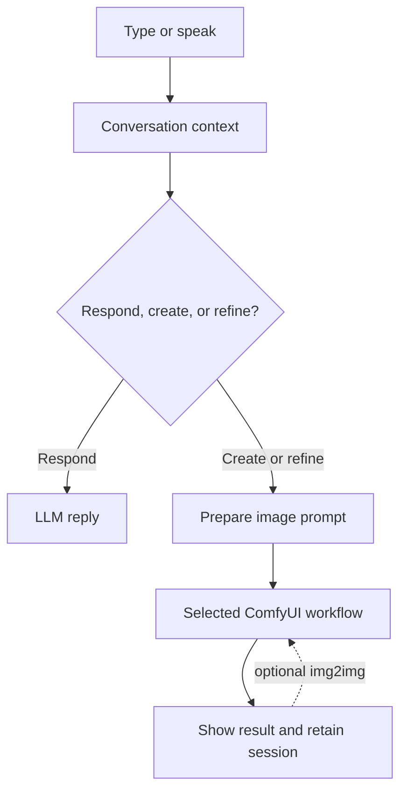

# Lumo

**Turn an idea into an image. Then keep refining it through conversation.**

Lumo is a desktop interface for AI image generation with [ComfyUI](https://github.com/comfyanonymous/ComfyUI) and an OpenAI-compatible language model. Type a request or speak to the agent, review the result, and ask for changes while keeping the current image and conversation in context.


## At a glance

- **Auto generate** — a familiar prompt-and-preset workflow for creating images.
- **Conversation mode** — ask for an image, then refine it with follow-up requests in the same session.
- **ComfyUI workflows** — choose an API-format workflow from your own ComfyUI setup.
- **Voice input** — speak through your microphone; transcription runs locally with faster-whisper.
- **English and Polish interface** — English is selected by default.
- **Your setup, your models** — connect a local or hosted OpenAI-compatible LLM and your ComfyUI server.

## Screenshots

### Choose a workspace


### Continue refining in a conversation

The image preview is the main workspace. Conversation, speech transcript, model and workflow controls, and task progress sit alongside it.


### Use the preset-based generator


## How it works

Lumo sends image-generation prompts to a ComfyUI workflow you provide. The language model helps interpret your request and prepare the prompt; ComfyUI runs the actual image-generation graph using the models and custom nodes installed on your system.

### Auto generate

Choose a preset and workflow, describe the image, and generate. Presets can supply optional style and prompt guidance. The generated image and prompt are shown in the app and can be saved locally.


### Conversation mode

Start with a new image idea, then make changes in the same conversation. Lumo keeps the current prompt and image session as context. If your selected workflow supports image-to-image input, Lumo can also pass the previous result into the next generation. Use **Start over** to clear the image context and begin a fresh conversation.



Voice transcription runs locally. The speech model may download on first use; after that, it runs on your computer. Text input is available even if microphone support is not set up.

## Requirements

- Windows 10/11 or Linux with a desktop environment
- Python 3.10 or newer
- A running [ComfyUI](https://github.com/comfyanonymous/ComfyUI) server
- An OpenAI-compatible `/v1/chat/completions` endpoint, such as LM Studio or a compatible hosted service
- A ComfyUI workflow exported with **Save (API Format)**
- Optional voice input: a working microphone and audio support for `sounddevice`

Install any models and custom nodes required by your workflow in ComfyUI. Lumo does not bundle ComfyUI, model weights, custom nodes, or machine-specific workflow exports.

## Install and launch

### Windows

1. Install Python 3.10 or newer and ensure the `py` launcher is available.
2. Start ComfyUI and your chosen LLM server.
3. Run `run_windows.bat` from the Lumo folder. It creates a virtual environment, installs Python dependencies, and launches the app.
4. Open **Settings**, enter your LLM and ComfyUI connection details, and save.
5. Select **Auto generate** or **Conversation mode**.

### Linux

1. Install Python 3.10 or newer and the system dependencies needed by PySide6 and `sounddevice`.
2. Start ComfyUI and your chosen LLM server.
3. In a terminal, run `chmod +x run_linux.sh` if needed, then `./run_linux.sh` from the Lumo folder.
4. Configure the connections in **Settings**.

### Manual installation

```bash
python -m venv .venv
# Windows PowerShell: .venv\Scripts\Activate.ps1
# Linux: source .venv/bin/activate
python -m pip install --upgrade pip
python -m pip install -r requirements.txt
python main.py
```

## Connect your services

On first launch, Lumo starts with safe defaults. Configure connections from **Settings** and select **Save settings**. Settings are stored locally in `config.json`, which is excluded from Git. You can also copy `config.json.example` to `config.json` and edit it before launch.

### Language model

Enter the base URL for your OpenAI-compatible service (typically ending in `/v1`), an API key if required, and a model ID available from that service. Local endpoints commonly do not require an API key.

### ComfyUI

Enter the ComfyUI server URL, generation timeout, and—if needed—the output directory visible to Lumo. The workflow must be available through the ComfyUI API and use nodes and models installed on that server.

### Optional integrations

- **SSH lifecycle control** can run configured start, stop, and status commands for a remote LLM service. Supply the host, port, user, and a key path or password in Settings.
- **Telegram** can send generation results and receive agent commands. Add the bot token and chat ID in Settings. Keep bot credentials private.

## Use Lumo

### Auto generate

1. Select a preset and a ComfyUI API workflow.
2. Describe the image and choose **Generate / Start**.
3. Review the image and prompt history. Use **Archive prompts** to download saved prompts as a ZIP file.

The starter presets in `presets/` are neutral examples. For each preset, set `prompt_node_id` to the positive text-prompt node ID in your own workflow JSON.

### Conversation mode

1. Select an LLM model and ComfyUI workflow in the side panel.
2. Type a request, or choose **Speak** and talk into your microphone.
3. Review the generated image and request further changes in the same session.
4. Choose **Start over** to start a new image concept and clear the conversation context.

Image-to-image editing is optional and depends on the chosen workflow. When supported and enabled, Lumo uploads the previous result to ComfyUI for the next edit. Otherwise, the current conversation and prompt still provide context for follow-up requests.

The red **Cancel all** control stops active recording, speech playback, LLM requests, image generation, and a managed remote LLM service where possible.

## Workflows

Export workflows from ComfyUI using **Save (API Format)**. Place them in `workflows/` or select them from another location in the app. The `workflows/` folder intentionally contains no machine-specific exports.

Auto generate presets need the positive prompt node ID. Conversation mode can detect a clearly labeled positive prompt node; if detection is ambiguous, specify the node ID in workflow options. Image-to-image workflows also need compatible image-input and switch nodes.

Test your workflow in ComfyUI first and install its required models and custom nodes before selecting it in Lumo.

## Privacy and local data

Lumo stores connection settings in `config.json`; this may include API keys, Telegram credentials, and SSH details. Do not share this file or commit it to Git. Local prompt history and generated images can also contain private information. Review them before sharing project files or screenshots.

The repository's `.gitignore` excludes local configuration, runtime history, generated images, virtual environments, and credentials. Workflow exports are intentionally left for you to add from your own ComfyUI setup.

## Project structure

```text
agent/       LLM, ComfyUI, SSH lifecycle, Telegram, and generation logic
gui/         Launcher, generator, conversation view, settings, and translations
presets/     Preset definitions for Auto generate
workflows/   Add your own ComfyUI API workflow exports here
scr/         Screenshots used in this README
main.py      Application entry point
config.json.example  Safe example configuration
```

## Notes

- The interface language defaults to English; Polish is also available.
- ComfyUI, its model files and custom nodes, and any LLM endpoint are separate dependencies.
- The speech model is downloaded on first use and runs locally afterward.
- No license file is currently included. Add a license before describing Lumo as open source or accepting contributions under specific terms.
