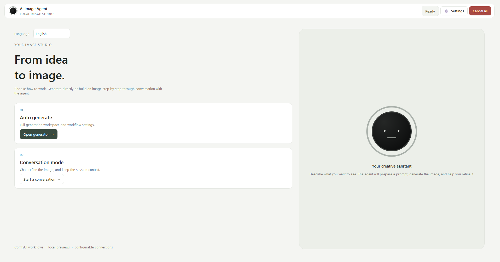
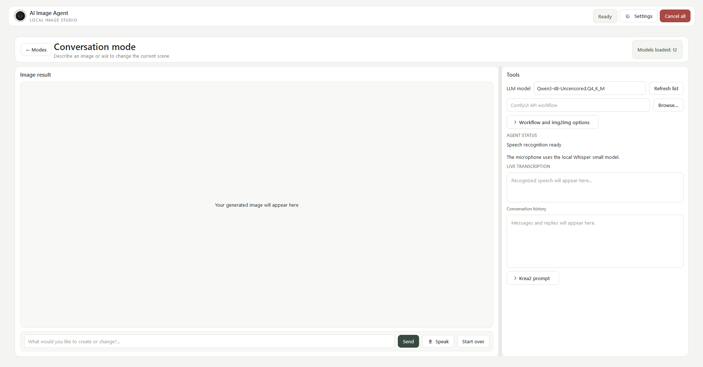
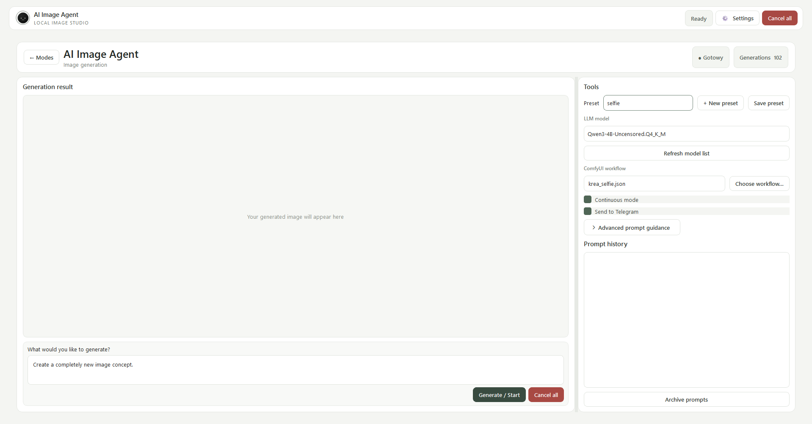
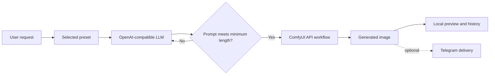
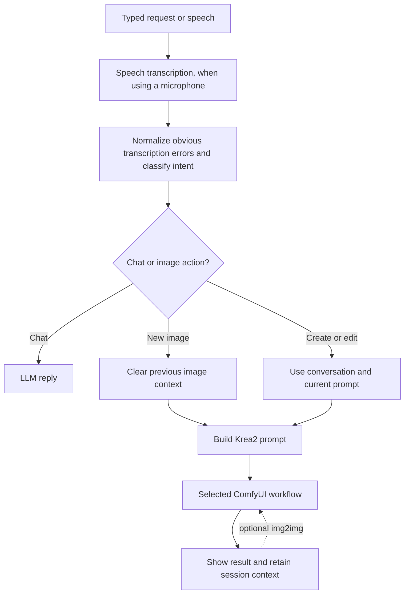

# Lumo

Lumo is a desktop app for creating and refining images with a language model and [ComfyUI](https://github.com/comfyanonymous/ComfyUI). Describe an idea in text or by voice, choose a ComfyUI API workflow, and review the generated image in the app. Conversation mode keeps the current image and discussion as context for follow-up edits.

The interface is available in English and Polish. English is the default; choose a language from the launcher. The selection is saved in the local configuration.

## Screenshots

### Home and mode selection

Choose between the original preset-based generator and a contextual conversation with the agent.



### Conversation mode

The generated image is the main workspace. Model and workflow controls, live transcription, conversation history, agent status, and the Krea2 prompt preview are available in the side panel.



### Auto generate

The original generator combines a prompt request with a selected preset and workflow.



## What it does

- Connects to an OpenAI-compatible chat-completions endpoint to prepare image prompts.
- Submits prompts to a ComfyUI server using an API-format workflow JSON file.
- Offers two workflows: **Auto generate**, which uses presets, and **Conversation mode**, which works from the live conversation and current image context.
- Supports text input and push-to-talk speech input. Speech is transcribed locally with faster-whisper.
- Supports optional image-to-image editing in conversation mode when the selected workflow has compatible image input and switch nodes.
- Keeps prompt history and generated files on the local machine, with optional Telegram notifications.
- Can start, stop, and check a remote LLM service over SSH when that option is configured.

## How generation works

### Auto generate

Auto generate is the original preset-based workflow. A preset can provide a base prompt, style, type, reference prompt, and additional instructions. The language model expands the user's request into an image prompt. The agent checks the prompt length and may ask the model for another variation before sending it to ComfyUI.



### Conversation mode

Conversation mode does not load prompt presets. The agent uses the conversation to decide whether to reply, create an image, edit the current image, or start a new image. It prepares a prompt for the Krea2 image workflow selected in ComfyUI. Follow-up requests can adjust the current image while preserving relevant scene details.



Speech recognition shows a live transcript in the side panel. The agent may correct an obvious recognition or grammar error before acting; if a phrase is genuinely ambiguous, it is instructed not to guess. The side panel shows the current task and completed prompt as progress information, not private model reasoning.

The speech model is downloaded the first time it is initialized and then runs locally. The current transcription configuration is optimized for Polish speech. Text input remains available regardless of microphone setup.

## Requirements

- Windows 10/11 or a recent Linux desktop environment
- Python 3.10 or newer
- ComfyUI running and reachable over HTTP
- An OpenAI-compatible `/v1/chat/completions` endpoint, for example LM Studio or another compatible local or hosted service
- A ComfyUI workflow exported in **API format** (`Save (API Format)`)
- For voice input: a working microphone and audio input support for `sounddevice`

The ComfyUI installation must have the models and custom nodes required by the chosen workflow. This clean distribution does not include machine-specific workflow exports; use an API-format workflow from your own ComfyUI installation.

## Install and run

### Windows

1. Install Python 3.10 or newer and make sure the Python launcher (`py`) is available.
2. Start ComfyUI and the LLM endpoint you plan to use.
3. Run `run_windows.bat` from the project folder. It creates `.venv` if needed, installs `requirements.txt`, and launches the app.
4. On first launch, open **Settings** and configure the LLM and ComfyUI connections. Save the settings.
5. Choose **Auto generate** or **Conversation mode** from the home screen.

The speech model may download the first time you use speech recognition. Allow network access for this initial download.

### Linux

1. Install Python 3.10 or newer and the system packages needed by PySide6 and `sounddevice` on your distribution.
2. Start ComfyUI and the LLM endpoint.
3. From the project folder, run `chmod +x run_linux.sh` if needed, then `./run_linux.sh`.
4. Configure the connections from **Settings** and save.

### Manual setup

```bash
python -m venv .venv
# Windows PowerShell: .venv\Scripts\Activate.ps1
# Linux: source .venv/bin/activate
python -m pip install --upgrade pip
python -m pip install -r requirements.txt
python main.py
```

## First-time configuration

Open **Settings** from the top bar. The app loads `config.json` if it exists; otherwise it uses safe defaults. You can copy `config.json.example` to `config.json` and edit it, or enter your connections in the Settings page and select **Save settings**. `config.json` is excluded from Git.

### Language model

- **API address**: the base URL for the compatible endpoint, usually ending in `/v1`.
- **API key**: optional for local servers; required by some hosted endpoints.
- **Model**: a model ID available from the configured server.
- **Timeout and generation parameters**: tune request duration and sampling behavior.

### ComfyUI

Set the ComfyUI server address, generation timeout, and output folder. The output folder should match a directory or path that the app can access for generated files.

### Optional SSH lifecycle control

Enable **Manage server over SSH** to let the app run configured start, stop, and status commands for a remote LLM server. Configure the host, port, username, and either an OpenSSH key path or a password. Host verification uses the machine's `known_hosts` file; add and verify the remote host there before connecting.

### Optional Telegram

Telegram integration can send generation notifications and results and accept agent commands. Configure the bot token and chat ID in Settings. Keep the token private. Result delivery can be enabled separately from bot command handling.

## Using the two modes

### Auto generate

1. Select a preset from the right-hand panel.
2. Select a ComfyUI API workflow.
3. Enter what you want to generate and choose **Generate / Start**.
4. Review the result and prompt history. Use **Archive prompts** to create a ZIP archive of saved prompts.

Neutral starter presets live in `presets/`. Choose a workflow exported from your ComfyUI installation. Before generating, replace `__SET_POSITIVE_PROMPT_NODE_ID__` in the selected preset JSON with the positive text-prompt node ID from that workflow. The preset's advanced prompt fields are intended for optional, project-specific guidance.

### Conversation mode

1. Select the chat model and a ComfyUI API workflow in the side panel.
2. Type a request in the input at the bottom, or select **Speak** and talk into the microphone.
3. Review the result in the large preview. Ask for a follow-up change to continue the same image session.
4. Use **Start over** when you want a new image concept and cleared LLM context.

The agent retains the current prompt and conversation context for follow-up edits. Image-to-image input is optional. If enabled, the app uploads the previous result to ComfyUI and uses it as the input image on the next edit. This requires a compatible `LoadImage` node and workflow switch. Without img2img, the agent still uses the current prompt and conversation to maintain scene continuity.

The small red **Cancel all** control in the top bar stops active recording, speech output, LLM requests, image generation, and a managed remote LLM service where possible.

## Workflows

Place your ComfyUI API workflow exports in `workflows/` or select them from another location. In conversation mode, optional advanced controls let you specify node IDs for the prompt, image input, and switch. Automatic node detection is used when the workflow is unambiguous.

Install the models and custom nodes required by your workflow in ComfyUI and verify the workflow there before using it with the agent.

## Project layout

```text
agent/       LLM, ComfyUI, SSH lifecycle, Telegram, state, and generation logic
gui/         Launcher, auto generator, conversation UI, settings, translations, and visuals
presets/     Preset definitions used by Auto generate
workflows/   ComfyUI API workflow JSON files
prompts/     Locally saved generated prompts
generated/   Generated images (runtime output)
scr/         Screenshots embedded in this README
config.json.example  Safe starter configuration; copy to config.json and add local settings
config.json  Local connection settings and credentials (ignored by Git)
state.json   Local generation history/state (ignored by Git)
input.json  Runtime request data created by Auto generate (ignored by Git)
main.py      Application entry point
```

## Data and security

`config.json` can contain LLM API keys, Telegram credentials, and SSH connection details. Do not commit it or paste credentials into issues, screenshots, or logs. The `.gitignore` excludes configuration, input/state files, virtual environments, Python caches, generated images, prompt history, and archives. Keep private workflow exports and runtime data out of commits.

Generated images and prompt records are local project data. Decide which examples, if any, you want to publish before adding runtime output to Git.

## Notes

- The interface language preference is stored under `ui.language` in `config.json` (`en` or `pl`). English is used when no preference is set.
- Auto generate uses neutral starter presets; Conversation mode is preset-free and builds image prompts for the selected Krea2-oriented workflow.
- ComfyUI, its model files, and any remote LLM service are external dependencies and are not installed by this project.
- No license is currently included. Add a license file before describing the project as open source or accepting contributions under specific terms.
